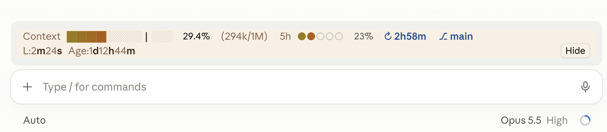
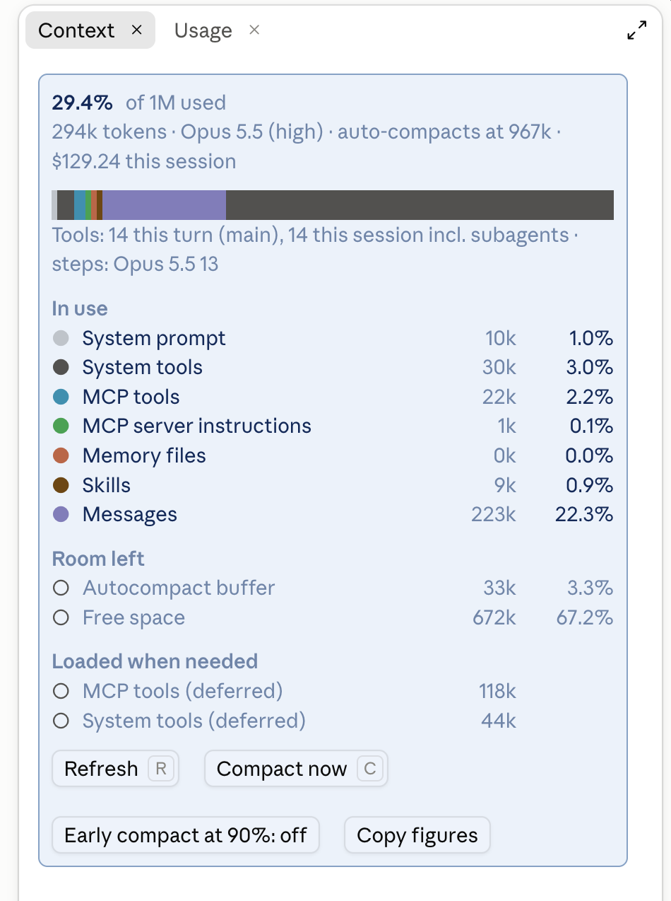
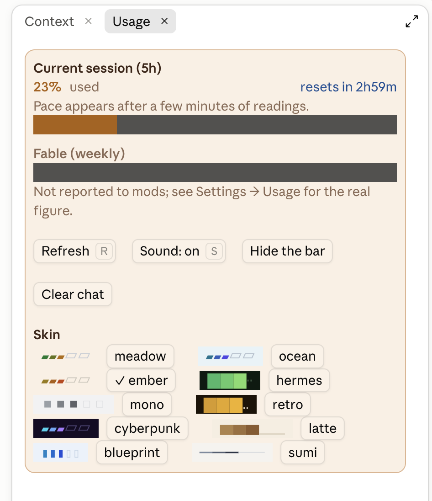
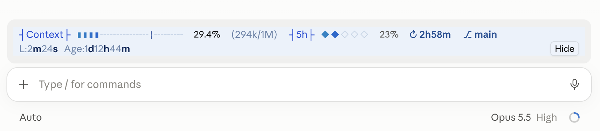

# Claude Context Bar

A status bar for Claude Code that sits above the prompt. It shows how full the context window is, how much of your 5-hour usage is gone and when it resets, the git branch, and how long the last turn and the session have run.



Click either percentage to open a panel with the details and controls.

## Install

In Claude Code, run these three commands:

```
/plugin marketplace add eddywong888/claude-context-bar
/plugin install context-bar@claude-context-bar
/reload-plugins
```

The bar appears after the reload. If it doesn't show up, restart Claude Code.

A mod is code that runs inside Claude Code on your machine, with the same access Claude Code has. Read the source in `hooks/` before installing, as you would with any package.

To update later:

```
/plugin marketplace update claude-context-bar
/plugin update context-bar@claude-context-bar
/reload-plugins
```

## The bar

| Part | What it means |
|---|---|
| **Context** gauge | How full the context window is, in a gradient from calm to full. The thin line marks 75%. The figure after it is the percent used, then tokens used out of the window, then how much the last turn added. Right after a compaction or `/clear` the figure is an estimate from `/context`, marked `~`, until Claude's next reply. |
| ⚠ auto-compact | Shows once the context is 85% of the way to the point where Claude Code compacts on its own. A **Compact** button appears from 70%. |
| **5h** dots | Your 5-hour usage: five dots, one per 20%. The ↻ countdown is the time until it resets, blue at first and amber, then red, as the limit nears. A notice shows when it resets. |
| **Fable** gauge | Shown only when Claude Code reports a Fable usage window. |
| ⎇ branch | The git branch, ✎ uncommitted files, ↑↓ commits ahead and behind. |
| **L** and **Age** | How long the last turn took, and how long the session has been open (days past 24 hours, e.g. `1d12h44m`). |
| ▶ working | The tool Claude is running now, and any subagents. |
| **Hide** | Folds the bar into small gauges. **Show** brings it back. |

## The panels

**Context** (click the context %) breaks down what fills the window: system prompt, tools, memory files, skills and messages, with the room left and what loads only when needed. It also shows the model, the auto-compact point, roughly how many turns are left before it, what the session has cost and how many tools ran. Buttons: Refresh, Compact now, Early compact at 90% (compacts just before Claude Code would) and Copy figures.



**Usage** (click the 5h %) shows each usage window with its reset time and, after a few minutes of readings, when you'd hit the limit at the recent pace. Buttons: Refresh, Sound (a short bell when Claude finishes a reply), Hide the bar and Clear chat. Below them is the skin picker.



The Fable weekly limit isn't reported to mods, so the panel points to Settings → Usage for it.

## Skins

Ten skins change the gauges' colours and glyphs, the bar and panel backgrounds, the text colours, the panel border and the labels: meadow (the default, in the app's own look), ocean, ember, hermes, mono, retro, cyberpunk, latte, blueprint and sumi. Pick one in the Usage panel; the choice is remembered across sessions.



Mods can't change the font, and the app draws its own buttons, so dark skins put the buttons on a light strip to keep them readable.

## Commands

| Command | What it does |
|---|---|
| `/contextbar` | Shows the current settings |
| `/contextbar show` / `hide` | Shows or folds the bar |
| `/contextbar sound on` / `off` | Turns the reply bell on or off |
| `/contextbar early on` / `off` | Turns early compaction on or off |
| `/contextbar theme <name>` | Picks a skin; with no name, lists them |

## What it runs, reads and sends

Everything stays on your machine. The mod makes no network requests.

| What | When and why |
|---|---|
| Runs `/compact` | Only when you press **Compact now** (or `c` in the Context panel), or when you turn on **Early compact at 90%**, which is off by default. Early compaction runs `/compact` once the context is 90% of the way to auto-compaction and Claude is idle. |
| Runs `/clear` | Only when you press **Clear chat** in the Usage panel. |
| Starts `git` | `git --no-optional-locks status --porcelain=v2 --branch` in the session's folder, for the branch, changed files and ahead/behind counts. It runs when the session starts and after a tool that writes files, at most once every 5 seconds. It never takes git's index lock or changes the repository. |
| Reads the session | Token counts, the `/context` breakdown, cost, usage windows, the model, and the running tools and subagents. The ▶ working line shows the first line of the running tool's input, with anything that looks like a token, key or password masked. |
| Sends data out | Only to your clipboard, when you press **Copy figures** (the context figures shown in the panel). |
| Plays a sound | `sounds/done.wav`, a short bell when Claude finishes a reply, if Sound is on. |
| Saves settings | Skin, sound, hidden and early-compact choices, in Claude Code's own store for the mod. |

Its hooks on tool calls, commands, subagent spawns and compaction pass every event on unchanged and only refresh the figures afterwards. The mod never blocks, changes, approves or denies anything, and it doesn't touch permission modes or settings.

## Develop

```bash
claude plugin validate .
claude plugin test .
```

Edits load with `/reload-plugins`. The bell is `sounds/done.wav`, an original sound from [claude-castle-mod](https://github.com/eddywong888/claude-castle-mod).

## License

[MIT](LICENSE)
